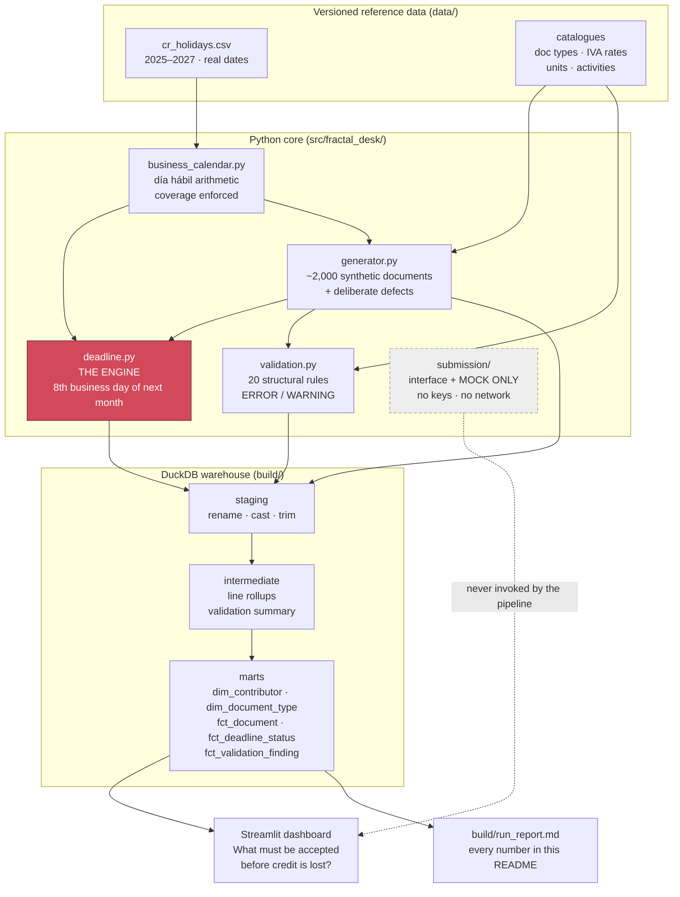

# fractal desk v2 — the deadline engine

**Costa Rican businesses lose IVA credit to a deadline nobody watches.** An
electronic document you *receive* must be accepted in TRIBU-CR within the first
eight business days of the following month. Miss that window and the credit is
gone permanently — there is no retroactive fix, and nothing tells you it
happened.

This computes that deadline correctly, tracks every received document against
it, and shows what has to be accepted before money is lost.

---

> ### 🔬 All data here is synthetic. No real filings are processed.
>
> Every document, taxpayer identifier and company name in this repository is
> **generated**. Nothing is real. Identifiers all begin `999` — a range Costa
> Rica does not issue. Company names all begin `SYN`. Every row in every table
> carries `is_synthetic = TRUE`, and the dashboard says so in a banner that
> cannot be dismissed.

> ### 🔒 No cryptographic keys. No live API calls. Structurally.
>
> The signing and submission layer is **an interface with a mock implementation
> only**. This repository contains **no cryptographic key**, no code that loads
> or uses one, **no HTTP client, no socket, and no endpoint URL** for any tax
> authority. `sign()` prepends a string and returns the input unchanged;
> `submit()` writes to a dictionary in memory.
>
> Those absences are load-bearing and **enforced by the test suite** — tests grep
> the source tree for transport and crypto imports and for credential-shaped
> files, and fail if any appear. Making this repository capable of real
> submission would mean writing the signing and transport layers from scratch,
> not flipping a flag.

> ### ⚠️ This is not a tax compliance product.
>
> It is a deadline-tracking and validation tool over synthetic data. **It files
> nothing.** It does not decide whether to accept or reject a document, what IVA
> rate applies to anything, or what goes on a return. See
> [REGULATORY_NOTES.md](./REGULATORY_NOTES.md) — and it is not tax advice.

---

## Setup

```bash
git clone <this-repo> && cd fractal-desk-v2
./run.sh                  # sets up, generates data, builds the warehouse, runs 224 tests
./run.sh dashboard        # opens the dashboard at localhost:8501
```

Python 3.11+. No accounts, no API keys, no cloud services, no paid anything.
Everything runs locally against a DuckDB file under `build/`.

---

## The rule, and why it is easy to get wrong

```
deadline(issue_date) = 8th business day of (issue month + 1)
```

It is **not** "eight business days after the invoice". The window is anchored to
the following month, so **every document issued in a month shares one deadline**.
A document issued 2 March and one issued 31 March are both due on the same day.

The other trap is holidays. March 2026's deadline:

| April 2026 | | Business day |
|---|---|---|
| Wed 1 | | **1** |
| Thu 2 | Jueves Santo | — |
| Fri 3 | Viernes Santo | — |
| Sat–Sun 4–5 | weekend | — |
| Mon 6 | | **2** |
| Tue 7 – Fri 10 | | **3–6** |
| Sat–Sun 11–12 | weekend | — |
| Mon 13 | | **7** |
| **Tue 14** | | **8 — deadline** |

Semana Santa moves it from 9 April to **14 April**. An engine that ignored
holidays would be five days optimistic, in the direction that costs money.

And the contrast that shows why the calendar has to be maintained data rather
than a fixed list: in **2025** Easter fell on 20 April, so Jueves and Viernes
Santo landed *after* the 8th business day and shifted nothing — March 2025's
deadline was 10 April. Same holiday, opposite effect.

---

## Architecture



**The deadline is computed in Python and lands in SQL as a fact table.** The SQL
layer consumes `fct_deadline_status`; it does not re-derive it. Business-day
arithmetic against a holiday file is awkward in SQL and easy to get subtly wrong
at month boundaries — exactly where this rule lives — it needs exhaustive unit
testing, and two implementations of a money-losing rule is one more than is
defensible.

---

## Measured results

Every number below comes from an actual run. Reproduce it with `./run.sh`; the
full output is written to `build/run_report.md`.

**Run:** seed `42`, as-of `2026-08-11`, Python 3.13.5, **4.26 seconds** end to
end.

### Volume

| | |
|---|---:|
| Documents generated | **2,022** |
| Document lines | 5,250 |
| Distinct claves | 2,000 |
| Records carrying a duplicated clave | 44 |
| Synthetic contributors | 49 |
| Documents subject to an acceptance deadline | 1,823 |
| Documents with no acceptance obligation (tiquetes) | 199 |
| SQL models built | 12 |
| Tests | **224**, all passing |

### Deadline status

| Status | Documents | IVA (₡) |
|---|---:|---:|
| `ACCEPTED` | 1,400 | 3,475,515,491 secured |
| `PENDING_SAFE` | 57 | 168,931,192 recoverable |
| `PENDING_AT_RISK` | **40** | **45,543,274 recoverable** |
| `EXPIRED_CREDIT_LOST` | 326 | **703,822,042 lost** |

**The headline:** on the evaluation date, **40 documents worth ₡45.5M of IVA
credit are three or fewer business days from expiry**, and ₡703.8M has already
been lost.

Of the 326 expired documents, **178 were actually confirmed — just too late**.
The source system records those as "accepted". The credit is gone anyway, so the
engine classifies them as `EXPIRED_CREDIT_LOST` and flags `accepted_late = TRUE`.
It reports outcome, not activity.

**Acceptance rate on closed windows: 79.22%.**

### Validation

435 findings across **13 of the 20 rules**, on 389 documents. 1,633 documents
(81%) are entirely clean — a dataset where everything is broken tests nothing.

Detection is exact. The generator records what it planted; the validator has to
find that specific defect, not merely some defect:

| Injected defect | Planted | Caught by | Caught |
|---|---:|---|---:|
| `INVALID_UNIT_OF_MEASURE` | 80 | V012 | **80** |
| `MISSING_ACTIVITY_CODE` | 72 | V007 | **72** |
| `DOCUMENT_IVA_MISMATCH` | 61 | V017 | **61** |
| `DUPLICATE_CLAVE` | 44 | V006 | **44** |
| `DOCUMENT_TOTAL_MISMATCH` | 36 | V018 | **36** |
| `LINE_IVA_MISCALCULATED` | 35 | V016 | **35** |
| `MALFORMED_ACTIVITY_CODE` | 34 | V008 | **34** |
| `MALFORMED_CLAVE` | 25 | V001 + V002 | **25** |
| `CLAVE_TYPE_DISAGREEMENT` | 18 | V005 | **18** |
| `MISSING_RECEIVER` | 14 | V011 | **14** |
| `CLAVE_DATE_DISAGREEMENT` | 11 | V004 | **11** |
| `MISSING_EXCHANGE_RATE` | 5 | V019 | **5** |

**Twelve defect classes, zero misses, zero false attributions.**

Two further generated conditions are stress cases rather than defects: **251
late arrivals** (documents reaching the business 20+ days after issue — the
upstream cause of most lost credit, and not fixable internally) and **148
documents on month boundaries**, where the deadline logic is most fragile.

Separately, **₡256,158,302** of stated document-level IVA does not reconcile
against the lines it was computed from. That figure is a column
(`iva_discrepancy_crc`), not just a finding count, because "142 documents fail
reconciliation" is a bug report and "₡256M of IVA does not match its own lines"
is a business case.

### The engine's defining property, on real output

Every issue month produced exactly **one** distinct deadline across all its
documents:

| Issue month | Documents | Deadline | Distinct deadlines |
|---|---:|---|---:|
| 2025-10 | 156 | 2025-11-12 | 1 |
| 2025-11 | 185 | 2025-12-11 | 1 |
| 2025-12 | 182 | **2026-01-13** | 1 |
| 2026-01 | 182 | 2026-02-11 | 1 |
| 2026-02 | 193 | 2026-03-11 | 1 |
| 2026-03 | 167 | **2026-04-14** | 1 |
| 2026-04 | 171 | 2026-05-13 | 1 |
| 2026-05 | 200 | 2026-06-10 | 1 |
| 2026-06 | 175 | 2026-07-10 | 1 |
| 2026-07 | 198 | 2026-08-12 | 1 |

December 2025 rolls into **13 January 2026** (New Year's Day is a Thursday, so
the window opens on the 2nd). March 2026 lands on **14 April** because Semana
Santa sits inside the window. Both are produced by the engine, not hardcoded.

### Test coverage, weighted where it matters

| Module | Tests |
|---|---:|
| **Deadline engine** | **47** |
| **Business-day calendar** | **38** |
| SQL model contracts | 43 |
| Validation rules | 40 |
| Synthetic generator | 29 |
| Submission mock + safety properties | 22 |
| Dashboard smoke test | 5 |
| **Total** | **224** |

**85 of 224 tests (38%) are on the deadline arithmetic alone.** Expected dates in
those tests are written as literals worked out by hand from a calendar — a test
that computes the expected value the same way the code does proves nothing.

---

## Dashboard

The primary view answers one question: **what must be accepted before credit is
lost.** Everything else sits below it or behind a tab. A deadline tool that opens
on a grid of charts makes you hunt for the thing that is on fire.

> **📸 Screenshots go here.** Run `./run.sh dashboard`, then capture:
>
> | Save as | What to capture |
> |---|---|
> | `docs/screenshots/01-action-queue.png` | The landing view — red banner, four metrics, at-risk queue |
> | `docs/screenshots/02-lost-credit.png` | 💸 Lost credit tab — lost-by-month chart and the supplier table |
> | `docs/screenshots/03-validation.png` | 🔍 Validation tab — defect-type bar chart |
> | `docs/screenshots/04-acceptance-trend.png` | 📈 Acceptance over time — rate line and status mix |
> | `docs/screenshots/05-engine.png` | ⚙️ The engine — deadline-per-month table and holiday calendar |
>
> Then replace this block with the images:
> ``

**Five tabs:**

1. **🔥 Action queue** — pending documents sorted by deadline, with business days
   left and IVA at stake in colones, plus where the exposure concentrates by
   supplier.
2. **💸 Lost credit** — what has already gone, split by *never accepted* versus
   *accepted too late*, and which suppliers cost the most.
3. **🔍 Validation** — failures grouped by defect type and severity, plus the
   worst quadrant: documents that are both defective and running out of time. A
   structural error usually means going back to the supplier, and that round trip
   has to fit inside a window that is already closing.
4. **📈 Acceptance over time** — rate by issue month, with open windows marked
   distinctly, since a month still in play cannot have a final rate.
5. **⚙️ The engine** — the deadline per issue month, the status definitions, and
   the holiday calendar in use.

---

## What is in the box

```
fractal-desk-v2/
├── README.md                  ← you are here
├── CASE_STUDY.md              ← Part A: the supervised UNA project (no code)
├── REGULATORY_NOTES.md        ← the rules implemented, sources, "verified as of"
├── DATA_DICTIONARY.md         ← every table, every column, every contract
├── run.sh                     ← one command, end to end
├── data/                      ← versioned reference data
│   ├── cr_holidays.csv                  real dates, 2025–2027
│   ├── catalog_document_types.csv
│   ├── catalog_tax_rates.csv            illustrative subset
│   ├── catalog_units_of_measure.csv     illustrative subset
│   └── catalog_economic_activities.csv  synthetic placeholders
├── src/fractal_desk/
│   ├── business_calendar.py   día hábil arithmetic, coverage enforced
│   ├── deadline.py            ★ the engine
│   ├── generator.py           synthetic documents + deliberate defects
│   ├── validation.py          20 structural rules
│   ├── models.py              v4.4 document shape, clave parsing
│   ├── warehouse.py           DuckDB loader + SQL runner
│   ├── pipeline.py            end-to-end run + report
│   └── submission/            interface + MOCK ONLY
├── sql/{staging,intermediate,marts}/    12 versioned models
├── app/streamlit_app.py
└── tests/                     224 tests
```

---

## Limitations

Stated plainly, because a tool about deadlines should be honest about its own
edges.

**The holiday calendar covers 2025–2027 and will go stale.** Costa Rican holidays
change: Jueves and Viernes Santo track Easter, and the Monday-transfer rule has
been switched on and off. The file must be maintained. The engine raises
`CalendarCoverageError` outside its range rather than assuming a year is
holiday-free — a silent wrong answer here would look completely normal in a
dashboard.

**Three of the four catalogues are not real data.** Units of measure and IVA
rate codes are illustrative subsets. **Economic activity codes are invented
placeholders** in the `9xxxxx` range. Rule V009 is a `WARNING` rather than an
`ERROR` precisely because of that — a validator should not be loudly confident on
the strength of data it made up. Each file says what it is in its own header.

**Validation is structural, not legal.** It checks that required fields are
present, well-formed, and that the arithmetic closes. It has no view on whether a
rate is the rate a product is entitled to, or whether an issuer is registered for
the activity claimed. Those need Hacienda's real catalogues and registry.

**No XML is parsed.** Documents are generated as Python objects on the v4.4
*shape*. A real ingestion path would parse signed XML, which brings namespace
handling, schema validation and signature verification — none of which is here.

**The "pago no obligatorio" holiday question is a judgement call.** Three of
Costa Rica's twelve national holidays carry a different pay rule. The engine
treats all twelve as non-business days by default, with a documented switch to do
otherwise. Reasoning in
[REGULATORY_NOTES.md § 3](./REGULATORY_NOTES.md#3-which-days-are-días-hábiles).

**The three-business-day at-risk threshold is not statutory.** It is an
operational choice, configurable.

**The as-of date is pinned** to `2026-08-11` so documented numbers stay
reproducible, and because that date is two business days before the deadline for
July-issued documents — the state the dashboard exists to show. Pass `--as-of` to
move it.

**Single-tenant, single-currency-of-record.** One receiving business, everything
reported in colones at each document's own exchange rate.

---

## What a production version would require

1. **Real ingestion.** Parse signed v4.4 XML, verify signatures, handle the
   `MensajeReceptor` schema — a different document from an invoice.
2. **Hacienda's real catalogues**, on a refresh path, since they version
   independently of any consuming repository.
3. **A Hacienda-issued cryptographic key** and its PIN, with real custody:
   hardware-backed or a managed secrets store, never on disk beside the code.
4. **XAdES-EPES signing** with the policy identifier the resolution specifies.
   Signature placement and canonicalisation are strict.
5. **The TRIBU-CR API connection** — authentication and reception endpoints, with
   separate sandbox and production credentials.
6. **Durable async submission.** Submission is acknowledged and answered later,
   so this needs persisted in-flight state and a retry policy that cannot
   double-submit.
7. **Rejection handling.** `rechazado` is a normal outcome, not an error, and it
   feeds back into the engine: a rejected document does not stop the clock.
8. **Multi-tenancy, alerting and authentication** — a deadline nobody is notified
   about is a deadline nobody watches, which is the original problem.

Detail in [REGULATORY_NOTES.md § 7](./REGULATORY_NOTES.md#7-what-a-real-implementation-would-need)
and `src/fractal_desk/submission/interface.py`.

---

## Two parts, clearly separated

This repository contains two things, and it matters which is which.

### Part A — [CASE_STUDY.md](./CASE_STUDY.md): the supervised UNA project

Fractal Desk **v1** was a CRM, project manager and electronic invoicing tool
built by **five informatics students at Universidad Nacional de Costa Rica**. I
supervised it as client-side sponsor and general director of Fractal Digital
Solutions: I owned requirements, scope, acceptance criteria, the delivery
schedule, dependency tracking and milestone review. **I did not write that code.**

**The v1 implementation is the intellectual property of UNA and the student
team.** None of it is reproduced, reconstructed or approximated anywhere in this
repository, and the case study contains no code. It documents how a delivery was
run — which was my work, and the only part of v1 I claim.

v1 was built against **ATV** and the electronic-document formats then in force.
Costa Rica replaced ATV with **TRIBU-CR on 6 October 2025** and made invoice
format **v4.4** mandatory from **1 September 2025**. The integration surface v1
targeted no longer exists.

### Part B — this repository: my own independent build

Written from scratch by me, against the new regime, over synthetic data, with no
keys and no live calls. It shares nothing with v1 but a domain.

Deliberately **not** a rebuild of v1. **No CRM. No project management. No
invoicing.** One wedge — the deadline — because that is the part with money
attached and no existing tool.

---

## Further reading

- **[CASE_STUDY.md](./CASE_STUDY.md)** — Part A: the engagement, how it was run,
  what changed mid-project, what I would do differently.
- **[REGULATORY_NOTES.md](./REGULATORY_NOTES.md)** — the rules implemented, the
  judgement calls, sources, and a dated "verified as of" line.
- **[DATA_DICTIONARY.md](./DATA_DICTIONARY.md)** — every table, column and
  contract.
- **`build/run_report.md`** — the full output of the last run.

---

MIT licensed. See [LICENSE](./LICENSE) — which covers this code only, not the v1
system described in the case study.
